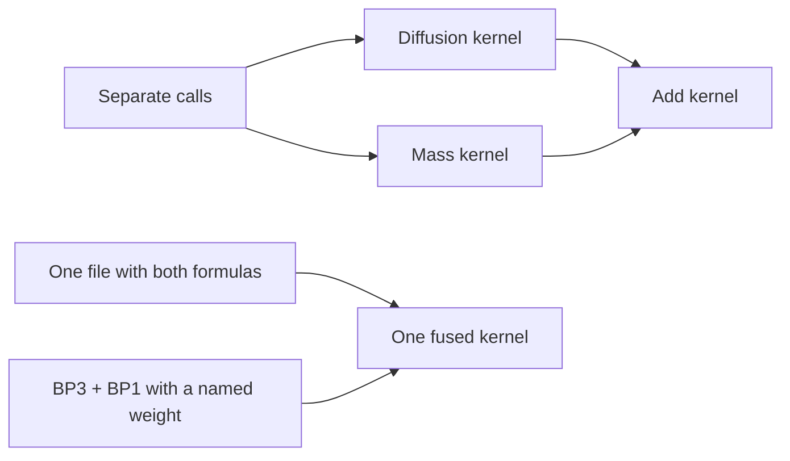

# marsir-compiler — MARSIR Stage 1 (operator spec → source)

A build-time compiler that turns a **weak-form operator spec** into specialized
GPU (and host) kernels for the MARS high-order matrix-free CVFEM path. You author
the *pointwise* flux once; MARSIR synthesizes the gather → contract → integrate →
scatter Knaus Algorithm-2 sweep around it and emits CUDA/HIP source. This is the
libCEED split — you write the QFunction (our `flux`), the compiler owns the E/B/D
structure. (Naming: the project is MARSIR — formerly mirage, formerly mir; the
Stage-2 MLIR dialect in `marsir-mlir/` is still named `mir`.)

**Separate by design.** `marsir` is its own tool with zero MARS build coupling: it
emits source that MARS compiles. MARS's build closure never pulls in the
compiler (or, in a later stage, LLVM). Only the *generated* `.cuh` enter MARS,
under `backend/distributed/unstructured/marsir/generated/`.

## Pipeline

```
specs/*.op  --frontend-->  Operator  --synthesize-->  ElementApply (IR)
                                                          |
        +----------------+----------------+---------------+----------------+
        v                v                v               v                v
   ir (dump)      cuda (.cuh)      host_cpp (.hpp)   tet_galerkin      mlir_ir (mir IR,
                                                     (collapsed tet)   the Stage-2 bridge)
```

- `marsir/expr.py` — arithmetic expression AST + parser + C renderer +
  `diff()`/`simplify()` (the whole "language").
- `marsir/frontend.py` — parse a `.op` spec into an `Operator`.
- `marsir/ir.py` — synthesize the `ElementApply` schedule; record which tangential
  derivatives / metric components the authored flux actually uses (so unused work
  is pruned).
- `marsir/backends/cuda.py` — emit the device apply, structurally a twin of
  `mars::fem::ho_cvfem_apply_kernel` (PerPoint, FP64) with the flux inlined,
  plus the JVP kernel and the HIP macro veneer (one header, nvcc + hipcc).
- `marsir/backends/host_cpp.py` — emit a host-C++ twin for local numeric validation.
- `marsir/backends/tet_galerkin.py` — the collapsed-coordinate (Duffy/PKD) tet
  Galerkin apply (see `TET_SUMFAC_HANDOFF.md`).
- `marsir/backends/mlir_ir.py` — emit the operator as textual `mir` dialect IR
  for `marsir-mlir/`: `emit` (the PA chain, `--backend mlir`), `emit_full` (the
  whole Knaus apply, `--backend mlir-full`), `emit_full_batched` (the fused
  single-kernel form, `--backend mlir-full-batched`). One `.op` feeds both stages.

## Usage

```bash
# IR dump (Stage-1 view: what the compiler will emit)
python3 marsir-emit.py specs/laplacian.op --backend ir

# CUDA header (the deliverable MARS compiles)
python3 marsir-emit.py specs/laplacian.op --backend cuda \
    -o ../backend/distributed/unstructured/marsir/generated/marsir_laplacian_apply.cuh

# Host twin (used by the local validation)
python3 marsir-emit.py specs/laplacian.op --backend host -o generated/laplacian_apply_host.hpp

# mir dialect IR (Stage 2; pipe into marsir-mlir/build/tools/mir-opt/mir-opt)
python3 marsir-emit.py specs/laplacian.op --backend mlir               # PA chain
python3 marsir-emit.py specs/laplacian.op --backend mlir-full          # full Knaus apply
python3 marsir-emit.py specs/laplacian.op --backend mlir-full-batched  # fused kernel form
```

## Operator spec

```
operator laplacian {
    element = hex
    form    = diffusion               # selects the Knaus Alg-2 skeleton
    flux    = g2*deriv + g0*dt2 + g1*dt1
}
```

At each subcontrol-surface quadrature slot the flux may reference: `deriv`
(normal derivative Dtil·u), `dt1`/`dt2` (tangential derivatives D·interp), and
`g0`/`g1`/`g2` (metric: tang2 r-axis, tang1 s-axis, normal). Change the flux and
the whole kernel regenerates — e.g. `specs/laplacian_orthocube.op` uses
`flux = g2*deriv`, and the compiler drops both tangential contractions and the
interp buffer automatically.

### Galerkin operators (`form = galerkin`)

A standard Galerkin operator on q^3 Gauss points (q = p + 2 by default), in the
libCEED QFunction split: the spec gives only the pointwise outputs at a Gauss point.
Inputs: `u` (the field's value there), `du0..du2` (its reference gradient), `g0..g5`
(per-point geometry the caller fills). Outputs: `v` (tested against the basis values),
`dv0..dv2` (tested against the reference gradient). The compiler builds only the sweeps
those names need: u -> B along each axis -> (D along axis d for each du_d read) ->
outputs -> (Dt along axis d of each dv_d) + v -> Bt along each axis.

```
operator bp1 {                    operator bp3 {
    element = hex                     element = hex
    form    = galerkin                form    = galerkin
    v       = g0*u                    dv0     = g0*du0 + g1*du1 + g2*du2
}                                     dv1     = g1*du0 + g3*du1 + g4*du2
                                      dv2     = g2*du0 + g4*du1 + g5*du2
                                  }
```

`specs/bp1.op` and `specs/bp3.op` are the CEED benchmark problems BP1 (mass, g0 = w
det J) and BP3 (Laplacian, g = the symmetric w det J J^-1 J^-T). `mlir_ir.emit_galerkin`
writes them as mir; `marsir-mlir/test/bp_gpu_pipeline.py` builds the PTX or the CPU
gate (`tools/emu_bp.cpp`: the emulated kernel against direct quadrature sums).

`geometry = trilinear` replaces `g0..g5` with `wdetj` (w det J) and `m00 m01 m02 m11
m12 m22` (w det J J^-1 J^-T) of the trilinear map, which the kernel computes at each
Gauss point from the element's 8 corners (`specs/bp1_tri.op`, `specs/bp3_tri.op`). The
kernel takes gq, wq (the 1D Gauss points and weights) and X (3 x 2 x 2 x 2 corners)
instead of G. A scalar mir.flux first turns the corners into the 21 coefficients of the
map's derivatives (7 per component; the mixed ones are shared by the three derivatives),
and the point flux reads them through `dims`, with a coordinate and weight per axis. Each
J entry is then 3 FMAs. So no geometry is stored or staged per point.

### Three ways to apply reaction and diffusion

Take a scalar temperature field `u`. Diffusion uses its gradient. Reaction uses its value, multiplied by a material coefficient. In the following example, every version computes the same element contribution. All coefficients include the quadrature weights and geometry needed by their term.

**1. Separate operators.** In the application, launch the two existing kernels and add their output arrays. The following is pseudocode for the three launches in the [benchmark driver](../tests/performance/reaction_diffusion/benchmark.cu).

```text
diff = apply(bp3, u, diffusion_metric)
mass = apply(bp1, u, sigma_w)
y = add(diff, mass)
```

**2. One manually combined operator.** Write a third specification and call it once. This copies the three diffusion expressions from [BP3](specs/bp3.op) and the mass expression from [BP1](specs/bp1.op).

```text
operator reaction {
    element = hex
    form = galerkin
    fields = sigma_w
    v   = sigma_w*u
    dv0 = g0*du0 + g1*du1 + g2*du2
    dv1 = g1*du0 + g3*du1 + g4*du2
    dv2 = g2*du0 + g4*du1 + g5*du2
}
```

**3. One operator composed from the two originals.** The complete [reaction.op](specs/reaction.op) definition is now one line. The application calls the same kernel with the same seven packed fields as in version 2.

```text
operator reaction = bp3 + bp1(g0=sigma_w)
```

The binding matters on a skew element. BP3's `g0` is the first entry of the diffusion metric. BP1 expects a scalar weight in its own slot zero. Here `sigma_w` supplies the reaction coefficient times the weighted volume. The compiler reads both files, binds that input, and adds contributions to each test-function output before lowering. Interpolation and the final transpose sweeps can then be shared.



The composed operands are scalar, stored-geometry Galerkin hex forms compiled at one degree and quadrature rule. References resolve to sibling `.op` files. Named fields with the same name refer to the same supplied array. A positional slot used by two operands needs an explicit binding to resolve its meaning. An unqualified `bp3 + bp1` therefore raises an error.

Run from the MARS repository root to inspect the expanded coefficients and outputs, then check the degree-three kernel against direct quadrature in the host emulator:

```sh
python3 marsir-compiler/marsir-emit.py marsir-compiler/specs/reaction.op
(cd marsir-mlir && python3 test/bp_gpu_pipeline.py reaction 3 --emulate)
```

On one GH200 at degree three, the split and manually combined versions took 148.1 and 123.2 µs, respectively, for one application over 32,769 warped elements with prepacked coefficients. The composed version regenerated the byte-identical SM90 PTX used for the 123.2 µs measurement.

## Local validation (no GPU)

```bash
python3 tests/validate_host.py
```

Emits the host twin, compiles it against the hand-written
`mars::fem::applyHoCvfemElement` oracle, and diffs the two on a distorted hex for
p=1..8. Current result: **bit-identical** (`parity_rel = 0`) at every order, with
the constant-nullspace invariant at machine precision. This proves the IR
captured the operator; the CUDA emission shares the same IR and flux rendering.

## Symbolic form differentiation → Jacobian / adjoint operators

The flux AST is closed (`Num/Var/Unary/Binary`), so it is closed under
differentiation. `Expr.diff()` + `simplify()` give **symbolic form
differentiation** (the same idea as UFL's `derivative()` in Firedrake/FEniCS,
not runtime autodiff): from one authored residual flux, the compiler derives the
**Jacobian-action (JVP) operator** — `J(u)·du = Σ_x (∂flux/∂x)·x_dot` over the
u-linear inputs — which rides the identical gather→contract→integrate→scatter
skeleton. This is the matrix-free tangent operator a Newton/FSI solve needs,
generated, not hand-written.

```bash
python3 marsir-emit.py specs/laplacian.op --backend ir        # shows the symbolic ∂flux/∂x + J·du
python3 marsir-emit.py specs/nldemo.op   --backend host-jvp   # emits the JVP host apply
python3 tests/validate_jvp.py                                 # numeric proof, p=1..8
```

`validate_jvp.py` checks two things: (A) for the **linear** Laplacian, `J(u)·du`
equals the primal `A·du` to reduction order (a linear operator is its own
Jacobian); (B) for a **nonlinear** demo flux, `J(u)·du` matches a central
finite difference `(F(u+εδu)−F(u−εδu))/2ε` — the independent proof that
`∂flux/∂x` is correct. Both PASS. Stays pure-Python/LLVM-free; real autodiff
(Enzyme) is reserved only for non-smooth fluxes (limiters, local sub-solves)
that symbolic diff can't reach.

## MARS integration + CUDA parity gate (Alps)

The committed generated header is consumed by the parity example
`examples/distributed/unstructured/mars_marsir_ho_apply.cu`, built with
`-DMARS_ENABLE_MARSIR=ON` (requires UNSTRUCTURED + CUDA). It runs the generated
kernel and the hand kernel on the same mesh / elemDof / metric `d_G` and diffs
them on device. **Validated on Alps GH200** (single rank, 16.7M elements):
generated primal == hand kernel at `gen_vs_hand_rel = 3.357e-16`; the JVP gate
`mars_marsir_jvp_test` gives `J_vs_FD_rel = 1.633e-10` vs central finite
differences on the nonlinear demo. Host sweeps p=1..8 are bit-identical
(`parity_rel = 0`).

## Status / roadmap

- **Done:** `.op` → IR → CUDA/HIP/host source; host parity bit-identical p=1..8;
  symbolic JVP (linear J==A ~2e-16, nonlinear vs FD ~1e-10); GH200 CUDA parity;
  collapsed-tet Galerkin backend (== dense oracle p=2..5); the mlir backends
  feeding Stage 2 (all six Stage-2 execution gates pass on their output).
- **Next:** a CUDA/HIP tet kernel from the tet backend; a proper `element = tet`
  spec with authored flux + tet symbolic diff; persist the tet reference basis
  library (`validate_tet.py` still needs `MARSIR_TET_ORACLE`); wire the generated
  JVP as the Newton matvec; the launch-parameter autotuner.
- **Stage 2 (real, alive):** the `mir` MLIR dialect in `marsir-mlir/` — lowering
  passes, FP64 DMMA tensor-core schedule, warp distribution. See
  `marsir-mlir/README.md` and `internal-notes/marsir_full_tutorial.md`.

### Named quadrature fields on stored-geometry hexes

A Galerkin specification can declare a comma-separated list such as
`fields = sigma_w, density` and read those names in pointwise expressions.
The caller supplies one scalar per element and quadrature point for each
declared field. In the existing packed argument `G[element, component, i, j, k]`,
components through the highest referenced geometry slot come first, followed by
the declared fields in order. For a form using only named fields, the first
declared field occupies slot zero. Weights and geometry factors are explicit
in the supplied values. See `specs/reaction.op` for a combined diffusion and
weighted reaction operator.
